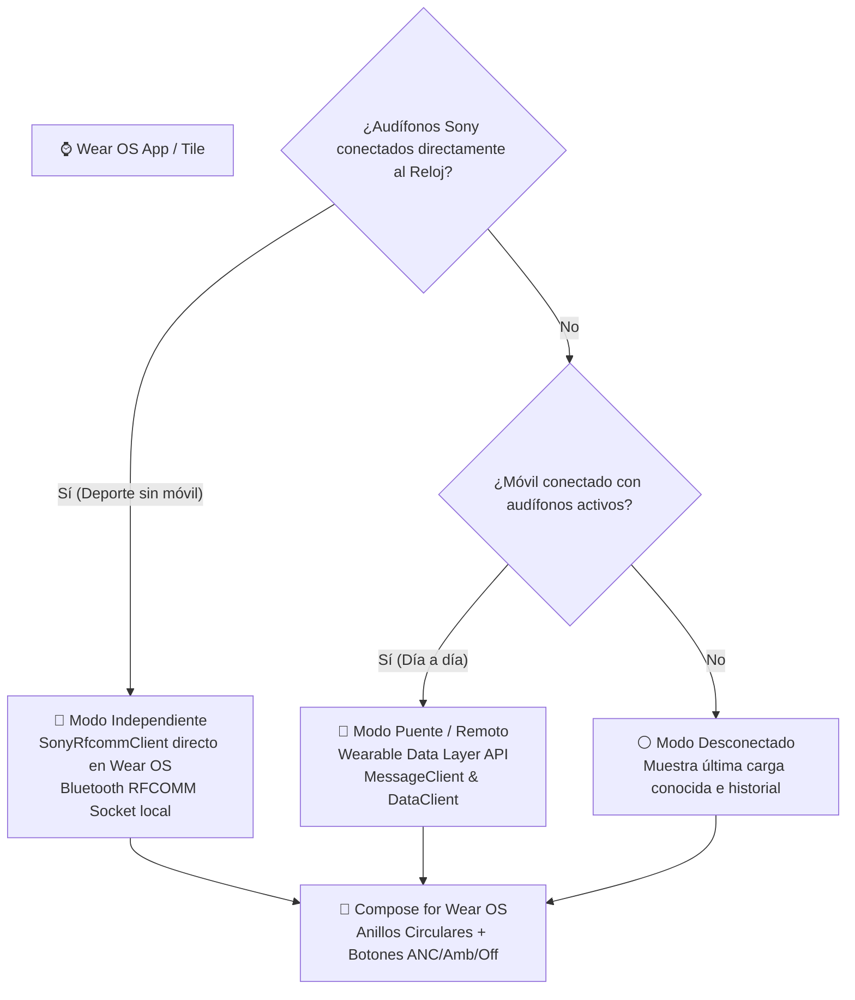

# ⌚ Master Context & Technical Roadmap: Porting NuclearWearable to Wear OS

> **Para el Agente / Chat de Wear OS:**
> Lee este documento completamente antes de modificar cualquier archivo. Contiene el estado **100% verificado y actualizado** del repositorio oficial de NuclearWearable v1.0.0, la arquitectura del protocolo Sony MDR RFCOMM, las dependencias exactas, el sistema de diseño visual (incluyendo el ícono oficial sin bordes blancos) y la estrategia de implementación para el módulo de Wear OS (Dual-Mode: Remoto + Independiente + Tile).

---

## 📌 1. Ficha Técnica y Estado del Repositorio Actual

| Parámetro | Valor Verificado en Producción |
| :--- | :--- |
| **Repositorio GitHub** | [`https://github.com/SebasNuclear/NuclearWearable`](https://github.com/SebasNuclear/NuclearWearable) |
| **Rama Principal** | `main` |
| **Autor / Identidad Git** | `SebasNuclear <sebaseripos@gmail.com>` |
| **Versión Actual** | `v1.0.0` (Version Code `20`) |
| **Application ID** | `com.nuclear.soundconnect` |
| **Android SDK Móvil** | `compileSdk = 35`, `targetSdk = 35`, `minSdk = 31`, `buildTools = 36.0.0` |
| **Versiones Base** | Android Gradle Plugin `8.13.2`, Kotlin `1.9.24`, JVM `17`, Compose Compiler `1.5.14` |
| **Almacén de Firma (Keystore)** | `nuclear_ecosystem.keystore` (Ubicado en `app/nuclear_ecosystem.keystore`) |
| **Contraseñas Keystore** | `storePassword = "nuclear_ecosystem"`, `keyAlias = "nuclear"`, `keyPassword = "nuclear_ecosystem"` |

> [!CRITICAL]
> **Regla de Oro de Wearable Data Layer:**
> Para que la app del teléfono y la del reloj puedan comunicarse sin problemas mediante Google Play Services Wearable API, **ambas DEBEN tener el mismo `applicationId` (`com.nuclear.soundconnect`) y estar firmadas con el mismo certificado (`nuclear_ecosystem.keystore`)**.

---

## 🎨 2. Ícono Oficial y Sistema de Diseño NuclearUI

El ícono oficial de la aplicación fue rediseñado y aprobado en la v1.0.0. **El módulo de Wear OS debe utilizar este mismo ícono**, adaptado a formato circular:

### 2.1. Archivos del Ícono Existentes
* **Vectores Android:**
  * Fondo OLED: `app/src/main/res/drawable/ic_launcher_background.xml` (Glow radial centrado `#18181D` sobre `#101013`).
  * Audífono WF-1000XM6: `app/src/main/res/drawable/ic_launcher_foreground.xml` (Audífono Sony buque insignia con almohadilla inferior, grabado vertical dorado de Sony `#D4AF37`, cápsula frontal con bisel suave y rejillas de micrófono acústico duales).
  * Iconos adaptativos: `app/src/main/res/mipmap-anydpi-v26/ic_launcher.xml` y `ic_launcher_round.xml`.
* **Imagen PNG Oficial:**
  * `docs/app_logo.png` (512x512 px, RGBA de 32 bits, **100% transparente en las esquinas**, sin fondo blanco residual).
  * Alternativa de silueta pura: `docs/icon_earbud_transparent.png`.

### 2.2. Paleta de Color NuclearUI (OLED Minimalist)
* **Fondo Principal:** `#000000` (Negro absoluto para pantallas AMOLED de relojes).
* **Superficies y Tarjetas:** `#101013` y `#181A22`.
* **Acento Batería Normal:** `#34C759` (Verde iOS / One UI).
* **Acento Nuclear:** `#00E676` (Verde atómico para estados activos).
* **Acento Sony:** `#D4AF37` (Dorado tenue para detalles premium y grabado).
* **Borde Sutil:** `rgba(255, 255, 255, 0.12)`.
* **Texto Primario:** `#FFFFFF` (Sentence Case, sin mayúsculas agresivas).
* **Texto Secundario:** `#9E9E9E` / `#A0A0B0`.

---

## ⚙️ 3. Arquitectura del Protocolo Sony MDR RFCOMM (100% Verificado)

Toda la lógica de comunicación con los audífonos Sony reside en el paquete `com.nuclear.soundconnect.bluetooth`. A continuación se detallan los componentes exactos y vigentes:

### 3.1. UUIDs de Servicio Bluetooth
```kotlin
val UUID_SONY_V2: UUID = UUID.fromString("956c7b26-d49a-4ba8-b03f-b17d393cb6e2")
val UUID_SONY_FALLBACK: UUID = UUID.fromString("96cc203e-5068-46ad-b32d-e316f5e069ba")
```

### 3.2. Estructura de Trama Sony MDR (`SonyProtocolParser.kt`)
* **Marcadores de delimitación:** Inicio `START_MARKER = 0x3E`, Fin `END_MARKER = 0x3C`, Escape `ESCAPE_BYTE = 0x3D`.
* **Tipos de datos:** MDR Data `0x0C`, ACK `0x01`.
* **Comandos Clave:**
  * Consulta Batería: `CMD_GET_BATTERY = 0x22` (Respuesta: `CMD_RET_BATTERY = 0x23`).
  * Consulta ANC/Ambiente: `CMD_GET_NC_ASM = 0x66` (Respuesta: `CMD_RET_NC_ASM = 0x67`).
  * Enviar Modo ANC/Ambiente: `CMD_SET_NC_ASM = 0x68` (Categoría `0x17`).
* **Métodos Principales de `SonyProtocolParser`:**
  * `buildDualBatteryQueryPacket(seq: Byte): ByteArray` -> Batería L y R (TWS modernos).
  * `buildCaseBatteryQueryPacket(seq: Byte): ByteArray` -> Batería Estuche.
  * `buildSingleBatteryQueryPacket(seq: Byte): ByteArray` -> Batería Diademas (Over-Ear y Neckband).
  * `buildNcAsmQueryPacket(seq: Byte): ByteArray` -> Consulta estado actual de cancelación de ruido.
  * `buildSetNcAsmPacket(mode: NoiseControlMode, ambientLevel: Int, voiceFocus: Boolean, seq: Byte): ByteArray` -> Genera la trama de control.
  * `parseFrames(buffer: ByteArray): List<ParsedFrame>` -> Desencapsula, valida checksum y desempaqueta.
  * `parseBatteryPayload(payload: ByteArray, currentState: HeadsetState): HeadsetState` -> Extrae porcentajes y pines de carga.
  * `parseNcAsmPayload(payload: ByteArray, currentState: HeadsetState): HeadsetState` -> Extrae modo ANC/Ambiente/Off.

### 3.3. Manejo de Conexión y Concurrencia (`SonyRfcommClient.kt`)
* **Preempción de Usuario:** Al llamar a `setNoiseMode()`, se cancela cualquier corrutina pasiva de sondeo (`activeSyncJob?.cancel()`), liberando el socket inmediatamente.
* **Margen de Asentamiento:** Tras enviar `SET_NC_ASM`, se espera el ACK del chip Sony (hasta 200ms) más un margen de 80ms para que el DSP estabilice el modo antes de liberar el socket.
* **Inmunidad Acústica:** No se envían ráfagas automáticas de batería durante los 5 segundos posteriores a un cambio manual de modo de ruido.

### 3.4. Modelos y Catálogo (`SonyModels.kt`)
* **52+ modelos soportados en 16 familias industriales:** `WF-1000XM6`, `XM5`, `XM4`, `XM3`, `WH-1000XM6..XM2`, `LinkBuds S`, `LinkBuds Open`, `WF-C700N`, `WF-C500`, `WH-CH720N`, `WH-CH520`, `ULT WEAR`, `INZONE Buds`, `WI-1000X`, `WI-C100`, etc.
* **Filtro Inteligente de Hardware (`hasAnc: Boolean`):** Si el modelo activo no cuenta con cancelación física (ej. `WF-C500`, `WH-CH520`, `WI-C100`, `LinkBuds Open`), `modelFamily.hasAnc` devuelve `false`, y la interfaz debe ocultar automáticamente los botones de ANC/Ambiente.
* **Estructura de Estado:**
  ```kotlin
  data class HeadsetState(
      val deviceName: String = "WF-1000XM6",
      val deviceAddress: String = "",
      val isConnected: Boolean = false,
      val isBusy: Boolean = false,
      val deviceType: DeviceType = DeviceType.TWS, // TWS o OVER_EAR
      val leftBattery: BatteryInfo = BatteryInfo(-1, false),
      val rightBattery: BatteryInfo = BatteryInfo(-1, false),
      val caseBattery: BatteryInfo = BatteryInfo(-1, false),
      val singleBattery: BatteryInfo = BatteryInfo(-1, false),
      val noiseMode: NoiseControlMode = NoiseControlMode.ANC, // ANC, OFF, AMBIENT
      val ambientLevel: Int = 20,
      val voiceFocus: Boolean = false,
      val lastSyncTime: Long = System.currentTimeMillis(),
      val forcedModelFamily: SonyModelFamily? = null
  )
  ```

---

## ⌚ 4. Arquitectura de la Solución Wear OS (Dual-Mode)

La aplicación de Wear OS debe ser una experiencia completa y autónoma que resuelva las dos situaciones del usuario:



### 4.1. Modo Puente / Remoto (Companion via Google Play Services Wearable)
* **Canal Teléfono -> Reloj (`DataClient` / `PutDataMapRequest`):**
  * Ruta: `/nuclear/state`
  * El teléfono envía un paquete DataItem cada vez que `SonyHeadsetRepository.state` cambia.
  * Claves: `connected` (Bool), `device_name` (String), `device_type` (String), `model_family` (String), `has_anc` (Bool), `bat_left` (Int), `bat_left_chg` (Bool), `bat_right` (Int), `bat_right_chg` (Bool), `bat_case` (Int), `bat_case_chg` (Bool), `bat_single` (Int), `noise_mode` (String: ANC/AMBIENT/OFF), `last_sync` (Long).
* **Canal Reloj -> Teléfono (`MessageClient`):**
  * Rutas:
    * `/nuclear/cmd/set_noise_mode` -> Payload: byte `0` (ANC), `1` (OFF), `2` (AMBIENT).
    * `/nuclear/cmd/request_sync` -> Solicita al móvil que sondee inmediatamente la batería.
  * En el teléfono, un `WearableListenerService` (ej. `NuclearPhoneWearableService`) intercepta el mensaje y ejecuta `repository.setNoiseModeAsync(mode)`.

### 4.2. Modo Independiente / Standalone (Direct Bluetooth en el Reloj)
* Si el usuario sale a correr o deja el teléfono y empareja los Sony directo a su Galaxy Watch o Pixel Watch:
  * El reloj utiliza `BluetoothAdapter.getBondedDevices()` buscando dispositivos Sony con `SonyHeadsetRepository.isSonyAudioDevice()`.
  * Si detecta conexión Bluetooth local activa, abre el socket `SonyRfcommClient` directamente en Wear OS para cambiar el modo y consultar la carga.

### 4.3. Wear OS Tile (Tarjeta Deslizable de Acceso Rápido)
* Implementar un `TileService` (`androidx.wear.tiles:tiles` + `androidx.wear.protolayout:protolayout`).
* Vista previa inmediata en la carátula sin abrir la app:
  * Icono del modelo o audífono en el centro.
  * Porcentajes L / R / Case (o Diadema).
  * Chips táctiles rápidos para alternar entre ANC y Modo Ambiente con un toque.

---

## 🛠️ 5. Hoja de Ruta de Implementación Paso a Paso (Para el Nuevo Chat)

### Paso 1: Reorganización Modular en Gradle
1. En `settings.gradle.kts`:
   ```kotlin
   include(":app")
   include(":wear")
   ```
2. Crear la carpeta `wear/` con su `build.gradle.kts` configurado para Wear OS:
   * `applicationId = "com.nuclear.soundconnect"` (¡Estrictamente idéntico a `:app`!)
   * `minSdk = 30` (Wear OS 3+), `compileSdk = 35`, `targetSdk = 35`.
   * Misma configuración `signingConfigs.release` apuntando a `../app/nuclear_ecosystem.keystore`.
   * Dependencias de Wear OS:
     ```kotlin
     implementation("androidx.wear.compose:compose-material:1.3.1")
     implementation("androidx.wear.compose:compose-foundation:1.3.1")
     implementation("androidx.wear.compose:compose-navigation:1.3.1")
     implementation("androidx.wear:wear-tooling-preview:1.0.0")
     implementation("com.google.android.gms:play-services-wearable:18.2.0")
     implementation("androidx.wear.tiles:tiles:1.3.0")
     implementation("androidx.wear.protolayout:protolayout:1.1.0")
     implementation("androidx.wear.protolayout:protolayout-material:1.1.0")
     implementation("com.google.android.horologist:horologist-compose-layout:0.6.17")
     ```
3. Compartir el código de Bluetooth:
   * Opción recomendada: Mover `SonyModels.kt`, `SonyProtocolParser.kt` y `SonyRfcommClient.kt` a un módulo `:core` o `:common`, O enlazar los archivos fuente en el `sourceSets` de `:wear`.

### Paso 2: Implementar la Capa de Sincronización en el Teléfono (`:app`)
1. Agregar `com.google.android.gms:play-services-wearable:18.2.0` al `build.gradle.kts` de `:app`.
2. Crear `NuclearPhoneWearableService.kt` extendiendo `WearableListenerService`:
   * Escucha mensajes en `/nuclear/cmd/*` y llama a `SonyHeadsetRepository`.
   * Observa `SonyHeadsetRepository.state` y sincroniza automáticamente hacia `/nuclear/state` con `DataClient`.

### Paso 3: Construir la Interfaz de Usuario en Wear OS (`:wear`)
1. **Pantalla Principal (`WearMainActivity.kt`):**
   * Usar `Scaffold` de Wear Compose con `TimeText` y `PositionIndicator`.
   * Vista circular con los 3 arcos de batería (Izquierdo, Derecho, Estuche) adaptados a pantalla redonda.
   * Botones de conmutación de cancelación de ruido ergonómicos para dedos:
     * Botón ANC (Verde / Gris).
     * Botón Ambiente (Azul / Gris).
     * Botón Desactivado.
     * Si `!modelFamily.hasAnc`, ocultar botones y centrar el indicador de batería.
   * Soporte para desplazamiento con bisel rotatorio (Rotary Scroll).

### Paso 4: Construir el Wear OS Tile (`NuclearTileService.kt`)
1. Crear el servicio de Tile para que el usuario pueda añadir la tarjeta de NuclearWearable en su reloj.
2. Renderizar con `LayoutElementBuilders`:
   * Fila superior: Estado de conexión y nombre del modelo.
   * Fila central: 3 cápsulas de batería (L / R / Case).
   * Fila inferior: 2 botones circulares compactos de acción rápida (Alternar ANC / Modo Ambiente).

### Paso 5: Compilación y Verificación
1. Compilar `:app:assembleRelease` y `:wear:assembleRelease`.
2. Verificar que los hashes de firma coincidan exactamente con:
   ```powershell
   keytool -printcert -jarfile wear/build/outputs/apk/release/wear-release.apk
   ```
3. Probar la instalación en el reloj vía ADB Wi-Fi (`adb connect <IP_RELOJ>:5555`).

---

## 📝 Mensaje de Arranque Rápido para el Nuevo Chat

Al iniciar el nuevo chat, solo dile al asistente:

> *"Hola, vamos a desarrollar el módulo de Wear OS para NuclearWearable. Por favor lee detalladamente el archivo `PORT_WEAR_OS_CONTEXT.md` en la raíz del repositorio para que tengas todo el contexto técnico, la arquitectura del protocolo Sony y la hoja de ruta sin discrepancias, y comencemos con el Paso 1."*
