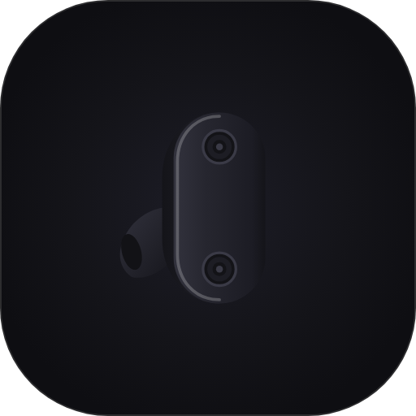

<div align="center">



# NuclearWearable

<strong>El ecosistema minimalista, moderno y sin telemetría para audífonos inalámbricos Sony en Android, Wear OS, Windows 10/11 y Linux.</strong><br />
<em>The minimalist, modern, telemetry-free ecosystem for Sony wireless headphones on Android, Wear OS, Windows 10/11, and Linux.</em>

<br />

<a href="#-español"><b>🇪🇸 Español</b></a> &nbsp;|&nbsp; <a href="#-english"><b>🇬🇧 English</b></a> &nbsp;|&nbsp; <a href="https://github.com/SebasNuclear/NuclearWearable/releases/tag/v1.1.0"><b>📥 Releases v1.1.0</b></a>

<br />


</div>

---

<a name="-español"></a>
## 🇪🇸 Español

**NuclearWearable** es una suite multiplataforma de código abierto diseñada para controlar y monitorear audífonos inalámbricos Sony mediante comunicación directa con el protocolo binario nativo **Sony MDR (V1/V2 Dual-Table `0x0C` + `0x0E`)** sobre Bluetooth RFCOMM/SPP. Ofrece una experiencia rápida, visualmente limpia y 100% privada en **Android 12+**, **Wear OS 3+**, **Windows 10/11** y **Linux**.

---

### 📸 Capturas del Ecosistema (v1.1.0)

#### Android — Audio Pro (EQ 10 Bandas), HUD de Códec, Confort & Multipunto
<p align="center">
  
</p>

#### Wear OS — Dashboard AMOLED Circular, Standalone BT & Tiles Vectoriales
<p align="center">
  
</p>

#### Escritorio (Windows x64 & Linux x64) — App Principal & Bandeja del Sistema
<p align="center">
  
</p>

#### Widgets Samsung One UI (3 Estilos) & Catálogo Vectorial (52+ Modelos)
<p align="center">
  
</p>

---

### 🌐 Ecosistema Multiplataforma y Novedades v1.1.0

| Categoría | Funcionalidades principales en v1.1.0 |
| :--- | :--- |
| **🔇 Control de Ruido Rápido** | Conmutación instantánea **ANC / Sonido Ambiente (nivel `1..20` + Enfoque en voz) / Desactivado**, filtro dedicado de ruido de viento para `WF-1000XM4` (`0x15`), **Quick Settings Tile nativo** en Android y preempción prioritaria en RFCOMM frente al sondeo de fondo. |
| **🎛️ Audio Hardware & EQEBB** | Presets oficiales Sony y ecualizador manual de **5 bandas (`-10..+10`) + Clear Bass**, además de **10 bandas (`0..12`, `31Hz..16kHz`)** en `WH-1000XM6`. Interruptor **DSEE / DSEE Extreme** y prioridad Bluetooth (**Calidad de sonido / Conexión estable / Baja latencia LE**). |
| **📡 Telemetría de Códec en Vivo** | HUD en tiempo real con el códec negociado (**`LDAC`**, **`aptX`**, **`AAC`**, **`SBC`**, **`LC3`**), frecuencia (`kHz`), profundidad (`bits`), canales, detección de llamadas HFP SCO y acceso directo a Ajustes BT (`AudioCodecMonitor` / `WindowsAudioMonitor` / `LinuxAudioCodecMonitor`). |
| **🧘 Bienestar, Gestos & Multipunto** | **Speak-to-Chat** (sensibilidad, tiempo de retorno y enfoque vocal), **Pausa al retirar audífonos**, **Apagado automático**, **Apagado remoto seguro (V2)**, reasignación táctil **L/R** y bloqueo táctil (`GS 0xD3`), **Guía de voz** (idioma/volumen) y **Multipunto (`PERI 0x0E`)** para 2 hosts simultáneos. |
| **📍 Automatización Local (0 Telemetría)** | Motor reactivo por evento de **llamada VoIP/celular**, **inicio de multimedia** y **horario local nocturno/estándar** con enfriamiento de 30s tras cambio manual. Sin GPS, sin Wi-Fi SSID y sin conexión a internet. |
| **🔊 Find My Buds & Respaldo JSON** | Baliza estéreo PCM 44.1 kHz aislada **100% al canal Izquierdo o Derecho** con rampa segura de 4s y apagado automático a los 20s. Exportación/importación **JSON (`NuclearBackupBundle` v1)** interoperable entre Android, Windows y Linux + **Modo Lab Hex** con filtro y export `.txt`. |
| **⌚ Wear OS 3+ AMOLED & Tiles** | App compañera + modo **Standalone Bluetooth RFCOMM directo** en el reloj, arcos de batería simétricos (`80°`), atenuación individual cuando un auricular está en el estuche, **Tiles con 3 círculos vectoriales in-place** (cambia ANC/Ambiente/Off sin abrir la app), **Complicación de carátula** fiel al modelo y selector de 12 colores. |
| **🪟 Widgets Samsung One UI** | 3 widgets de escritorio (`4x2 Dúo`, `Solo Batería`, `Solo Ruido`) con fondo squircle adaptativo (`0%..100%` opacidad), temas Claro/Oscuro OLED/Sistema y 3 estilos de anillos (**Minimalista**, **Medio Anillo `250°`**, **Anillo Completo `360°`**). |
| **💻 Windows x64 & 🐧 Linux x64** | **Windows:** RFCOMM nativo Winsock (`JNA`), WASAPI CoreAudio HUD, System Tray (`127.0.0.1:47831`) y `.exe` portable sin Java requerido. **Linux (Nuevo):** Port 100% **rootless (sin `sudo`)** con BlueZ D-Bus + JNA `libc` `AF_BLUETOOTH` + L2CAP SDP nativo + PipeWire/MPRIS + config XDG. |

---

### 📋 Modelos Sony Compatibles (52+)

Motor de detección de **3 capas** (Firmware Hardware `0x04 0x01` → Caché persistente por MAC → Catálogo manual con buscador) + **filtro inteligente ANC** que oculta controles de ruido en modelos de solo batería:

| Serie / Familia | Modelos cubiertos | Tipo |
| :--- | :--- | :--- |
| **1000X TWS Flagship** | `WF-1000XM6`, `WF-1000XM5`, `WF-1000XM4`, `WF-1000XM3` | True Wireless + Estuche |
| **1000X Diadema Flagship** | `WH-1000XM6` (EQ 10 bandas), `WH-1000XM5`, `WH-1000XM4`, `WH-1000XM3`, `WH-1000XM2`, `MDR-1000X` | Over-Ear ANC |
| **LinkBuds Series** | `LinkBuds Open (WF-L910)`, `LinkBuds (WF-L900)` (sin ANC), `LinkBuds S (WF-LS900N)`, `LinkBuds Fit (WF-LS910N)` | True Wireless + Estuche |
| **ULT & Extra Bass** | `WH-ULT900N (ULT WEAR)`, `WH-XB910N`, `WH-XB900N`, `MDR-XB950N1`, `MDR-XB950B1`, `MDR-XB650BT` | Over-Ear ANC |
| **Serie CH** | `WH-CH720N`, `WH-CH710N`, `WH-CH700N` / `WH-CH520`, `WH-CH510`, `WH-CH500` (solo batería) | Over-Ear / On-Ear |
| **Serie C TWS** | `WF-C700N`, `WF-C710N` / `WF-C500`, `WF-C510` (solo batería) | True Wireless |
| **Sport & Gaming** | `WF-SP800N`, `WF-SP700N`, `INZONE Buds (WF-G700N)` | True Wireless |
| **h.ear & Collarín** | `WH-H910N (h.ear on 3)`, `WH-H900N (h.ear on 2)`, `WI-1000X`, `WI-1000XM2`, `WI-C100`, `WI-C200`, `WI-C310`, `WI-XB400` | Over-Ear / Neckband |

---

### 📥 Descarga e Instalación — v1.1.0

Descarga el paquete para tus dispositivos desde [**Releases v1.1.0**](https://github.com/SebasNuclear/NuclearWearable/releases/tag/v1.1.0):

| Plataforma | Archivo | Tamaño | Verificación SHA-256 |
| :--- | :--- | :--- | :--- |
| **Android 12–15** | [`NuclearWearable_v1.1.0_release.apk`](https://github.com/SebasNuclear/NuclearWearable/releases/download/v1.1.0/NuclearWearable_v1.1.0_release.apk) | `40.0 MiB` (`41,981,678` B) | `CB57FE69AFA926D5BAC01EF1D6C1882E7DDBED9667E53DAFA6FA1C21AD5E90DD` |
| **Wear OS 3–5** | [`NuclearWearable_WearOS_v1.1.0_release.apk`](https://github.com/SebasNuclear/NuclearWearable/releases/download/v1.1.0/NuclearWearable_WearOS_v1.1.0_release.apk) | `26.8 MiB` (`28,146,350` B) | `030BAA2E6ED4B3E67EAD1E76AF70C1AF4F1C5B2204DDF79578B62D0253713330` |
| **Windows x64 Portable** | [`NuclearWearable_Windows_v1.1.0_release.exe`](https://github.com/SebasNuclear/NuclearWearable/releases/download/v1.1.0/NuclearWearable_Windows_v1.1.0_release.exe) | `120.2 MiB` (`125,987,328` B) | `839F2747C93FA2DC118CBFE0EA58E932672FC4DE2083603F83AACB454F9245B3` |
| **Linux x64 Desktop** | [`NuclearWearable_Linux_x64_v1.1.0.jar`](https://github.com/SebasNuclear/NuclearWearable/releases/download/v1.1.0/NuclearWearable_Linux_x64_v1.1.0.jar) | `76.8 MiB` (`80,576,089` B) | `92F3959DC0E7D1F9FC828166BF2DF1D1E5E1FEF67FF8102532E181082B033617` |

* **Emparejamiento Teléfono + Reloj:** Ambas APKs comparten firma unificada (`nuclear_ecosystem.keystore`, SHA-256 `bd944ae04a6fb8df7b7abd83c8209932188e3a2a793a860c51f3c5a770029784`) para autorizar la sincronización por *Wearable Data Layer*.
* **Privacidad verificada:** Cero permiso `INTERNET` en `:app`, `:core` y `:wear`, y cero permisos de ubicación (`neverForLocation` en `BLUETOOTH_SCAN`).
* **Linux x64:** Ejecución directa sin root (`sudo`) sobre BlueZ + PipeWire / PulseAudio (`JDK 17+`): `java -jar NuclearWearable_Linux_x64_v1.1.0.jar`.

> [!NOTE]
> **Aviso de distribución independiente (Google Play Protect / Windows SmartScreen):**  
> Al distribuirse fuera de tiendas comerciales, Android o Windows pueden mostrar un aviso preventivo de *"Desarrollador desconocido"*. En Android pulsa **Más detalles → Instalar de todas formas**; en Windows pulsa **Más información → Ejecutar de todas formas**. El ejecutable de Windows incluye su propio entorno JVM y no requiere instalar Java.

---

### 🏗️ Arquitectura y Compilación desde el Código Fuente

```text
NuclearWearable/
├── core/                  # Protocolo compartido Android + Wear OS (MDR V1/V2, ARQ, SonyModels, WearProtocol)
├── app/                   # App móvil Android (Jetpack Compose, Material 3, One UI Widgets, QS Tile, EQ/Lab/Backup)
├── wear/                  # App reloj Wear OS (Compose Wear AMOLED, Standalone RFCOMM, Vector Tiles, Complication)
├── windows/               # Cliente nativo Windows x64 (Compose Desktop, Winsock JNA, WASAPI HUD, Tray, EXE launcher)
├── linux/                 # Cliente nativo Linux x64 (Compose Desktop, BlueZ D-Bus + JNA libc AF_BLUETOOTH, PipeWire)
└── docs/                  # Guías de diseño NuclearUI, widgets y capturas oficiales (docs/screenshots/)
```

<details>
<summary>Instrucciones de compilación y tests por plataforma</summary>

```bash
# Clonar repositorio
git clone https://github.com/SebasNuclear/NuclearWearable.git
cd NuclearWearable

# Android & Wear OS (APKs Release + tests unitarios de :core)
./gradlew :app:assembleRelease :wear:assembleRelease
./gradlew :core:testReleaseUnitTest

# Windows x64 (desde windows/)
cd windows && .\gradlew.bat cleanTest test packageUberJarForCurrentOS --no-daemon

# Linux x64 (desde linux/)
cd linux && ./gradlew cleanTest test packageUberJarForCurrentOS --no-daemon
# Paquetes opcionales .deb / .AppImage:
./packaging/linux/build-linux.sh
./packaging/linux/appimage-build.sh
```

</details>

---

<a name="-english"></a>
## 🇬🇧 English

**NuclearWearable** is an open-source, multiplatform suite engineered to control and monitor Sony wireless headphones through direct binary communication with the native **Sony MDR (V1/V2 Dual-Table `0x0C` + `0x0E`)** protocol over Bluetooth RFCOMM/SPP. It delivers a responsive, clean, and 100% private experience across **Android 12+**, **Wear OS 3+**, **Windows 10/11**, and **Linux**.

---

### 📸 Ecosystem Screenshots (v1.1.0)

#### Android — Pro Audio (10-Band EQ), Live Codec HUD, Comfort & Multipoint
<p align="center">
  
</p>

#### Wear OS — Circular AMOLED Dashboard, Standalone BT & Vector Tiles
<p align="center">
  
</p>

#### Desktop (Windows x64 & Linux x64) — Main App & System Tray Flyout
<p align="center">
  
</p>

#### Customizable One UI Widgets (3 Styles) & Vector Model Catalog (52+ Models)
<p align="center">
  
</p>

---

### 🌐 Multiplatform Ecosystem & v1.1.0 Highlights

| Category | Key Capabilities in v1.1.0 |
| :--- | :--- |
| **🔇 Instant Noise Control** | Zero-latency switching between **ANC / Ambient Sound (level `1..20` + Voice Focus) / Off**, dedicated wind-noise reduction for `WF-1000XM4` (`0x15`), native Android **Quick Settings Tile**, and RFCOMM user-command preemption over background polling. |
| **🎛️ Hardware Audio & EQEBB** | Official Sony presets and custom **5-band (`-10..+10`) + Clear Bass** equalizer, plus full **10-band (`0..12`, `31Hz..16kHz`)** support on `WH-1000XM6`. Includes **DSEE / DSEE Extreme** toggle and Bluetooth priority (**Sound Quality / Stable Connection / Low Latency LE Audio**). |
| **📡 Live Codec Telemetry HUD** | Real-time display of the active codec (**`LDAC`**, **`aptX`**, **`AAC`**, **`SBC`**, **`LC3`**), sample rate (`kHz`), bit depth (`bits`), channel mode, HFP SCO call indicator, and quick link to Bluetooth settings (`AudioCodecMonitor` / `WindowsAudioMonitor` / `LinuxAudioCodecMonitor`). |
| **🧘 Comfort, Gestures & Multipoint** | **Speak-to-Chat** (sensitivity, recovery timeout, voice focus), **Pause When Removed**, **Auto Power Off**, safe **V2 Remote Power Off**, independent **L/R touch remapping** & touch lock (`GS 0xD3`), **Voice Guidance** language/volume, and **Multipoint (`PERI 0x0E`)** for 2 simultaneous hosts. |
| **📍 Zero-Telemetry Automation** | Fully offline reactive rules triggered by **VoIP/cellular calls**, **media playback start**, and **local night/day schedules** with a 30s manual override cooldown. Zero GPS, zero Wi-Fi SSIDs, and zero network connections. |
| **🔊 Find My Buds & JSON Backup** | Stereo 44.1 kHz PCM beacon isolated **100% to Left or Right channel** with a safe 4s volume ramp and 20s auto-stop. Cross-platform **JSON (`NuclearBackupBundle` v1)** export/import compatible across Android, Windows, and Linux + filtered **Hex Lab Mode** with `.txt` export. |
| **⌚ Wear OS 3+ AMOLED & Vector Tiles** | Companion sync + direct **Standalone Bluetooth RFCOMM** mode on watch, symmetric battery arcs (`80°`), per-earbud dimming when one bud is docked in the case, **in-place 3-circle vector Tiles** (switch ANC/Ambient/Off without launching the app), dynamic model **Complication**, and 12-color accent picker. |
| **🪟 Samsung One UI Widgets** | 3 home screen widgets (`4x2 Duo`, `Battery Only`, `Noise Only`) with adaptive squircle transparency (`0%..100%`), Light/OLED Dark/System themes, and 3 ring styles (**Minimal**, **Half Ring `250°`**, **Full Ring `360°`**). |
| **💻 Windows x64 & 🐧 Linux x64** | **Windows:** Native Winsock RFCOMM (`JNA`), live WASAPI CoreAudio HUD, System Tray (`127.0.0.1:47831`), and zero-install portable `.exe`. **Linux (New):** 100% **rootless** client powered by BlueZ D-Bus + JNA `libc` `AF_BLUETOOTH` + native L2CAP SDP + PipeWire/MPRIS + XDG config. |

---

### 📋 Supported Sony Models (52+)

**3-layer detection engine** (Hardware Firmware `0x04 0x01` → Persistent MAC Cache → Manual Searchable Catalog) + **smart ANC filter** that automatically hides noise control UI on battery-only headphones:

| Series / Family | Covered Models | Form Factor |
| :--- | :--- | :--- |
| **1000X TWS Flagship** | `WF-1000XM6`, `WF-1000XM5`, `WF-1000XM4`, `WF-1000XM3` | True Wireless + Case |
| **1000X Over-Ear Flagship** | `WH-1000XM6` (10-band EQ), `WH-1000XM5`, `WH-1000XM4`, `WH-1000XM3`, `WH-1000XM2`, `MDR-1000X` | Over-Ear ANC |
| **LinkBuds Series** | `LinkBuds Open (WF-L910)`, `LinkBuds (WF-L900)` (no ANC), `LinkBuds S (WF-LS900N)`, `LinkBuds Fit (WF-LS910N)` | True Wireless + Case |
| **ULT & Extra Bass** | `WH-ULT900N (ULT WEAR)`, `WH-XB910N`, `WH-XB900N`, `MDR-XB950N1`, `MDR-XB950B1`, `MDR-XB650BT` | Over-Ear ANC |
| **CH Series** | `WH-CH720N`, `WH-CH710N`, `WH-CH700N` / `WH-CH520`, `WH-CH510`, `WH-CH500` (battery only) | Over-Ear / On-Ear |
| **C Series TWS** | `WF-C700N`, `WF-C710N` / `WF-C500`, `WF-C510` (battery only) | True Wireless |
| **Sport & Gaming** | `WF-SP800N`, `WF-SP700N`, `INZONE Buds (WF-G700N)` | True Wireless |
| **h.ear & Neckband** | `WH-H910N (h.ear on 3)`, `WH-H900N (h.ear on 2)`, `WI-1000X`, `WI-1000XM2`, `WI-C100`, `WI-C200`, `WI-C310`, `WI-XB400` | Over-Ear / Neckband |

---

### 📥 Download & Installation — v1.1.0

Visit [**Releases v1.1.0**](https://github.com/SebasNuclear/NuclearWearable/releases/tag/v1.1.0) to download the binaries for your devices:

| Platform | Binary File | Size | SHA-256 Checksum |
| :--- | :--- | :--- | :--- |
| **Android 12–15** | [`NuclearWearable_v1.1.0_release.apk`](https://github.com/SebasNuclear/NuclearWearable/releases/download/v1.1.0/NuclearWearable_v1.1.0_release.apk) | `40.0 MiB` (`41,981,678` B) | `CB57FE69AFA926D5BAC01EF1D6C1882E7DDBED9667E53DAFA6FA1C21AD5E90DD` |
| **Wear OS 3–5** | [`NuclearWearable_WearOS_v1.1.0_release.apk`](https://github.com/SebasNuclear/NuclearWearable/releases/download/v1.1.0/NuclearWearable_WearOS_v1.1.0_release.apk) | `26.8 MiB` (`28,146,350` B) | `030BAA2E6ED4B3E67EAD1E76AF70C1AF4F1C5B2204DDF79578B62D0253713330` |
| **Windows x64 Portable** | [`NuclearWearable_Windows_v1.1.0_release.exe`](https://github.com/SebasNuclear/NuclearWearable/releases/download/v1.1.0/NuclearWearable_Windows_v1.1.0_release.exe) | `120.2 MiB` (`125,987,328` B) | `839F2747C93FA2DC118CBFE0EA58E932672FC4DE2083603F83AACB454F9245B3` |
| **Linux x64 Desktop** | [`NuclearWearable_Linux_x64_v1.1.0.jar`](https://github.com/SebasNuclear/NuclearWearable/releases/download/v1.1.0/NuclearWearable_Linux_x64_v1.1.0.jar) | `76.8 MiB` (`80,576,089` B) | `92F3959DC0E7D1F9FC828166BF2DF1D1E5E1FEF67FF8102532E181082B033617` |

* **Phone + Watch Sync:** Both APKs are signed with the same ecosystem certificate (`nuclear_ecosystem.keystore`, SHA-256 `bd944ae04a6fb8df7b7abd83c8209932188e3a2a793a860c51f3c5a770029784`), enabling direct *Wearable Data Layer* communication.
* **Verified Privacy:** Zero `INTERNET` permission in `:app`, `:core`, and `:wear`, and zero location permissions (`neverForLocation` on `BLUETOOTH_SCAN`).
* **Linux x64:** Runs rootless without `sudo` on BlueZ + PipeWire / PulseAudio (`JDK 17+`): `java -jar NuclearWearable_Linux_x64_v1.1.0.jar`.

> [!NOTE]
> **Independent Distribution Notice (Google Play Protect / Windows SmartScreen):**  
> When sideloading open-source binaries outside commercial stores, your OS may display an *"Unrecognized developer"* warning. On Android, tap **More details → Install anyway**; on Windows, click **More info → Run anyway**. The Windows executable bundles its own JVM runtime and needs no pre-installed Java.

---

### 🏗️ Monorepo Architecture & Building from Source

```text
NuclearWearable/
├── core/                  # Shared Android + Wear OS protocol (MDR V1/V2, ARQ, SonyModels, WearProtocol)
├── app/                   # Android mobile app (Jetpack Compose, Material 3, One UI Widgets, QS Tile, EQ/Lab/Backup)
├── wear/                  # Wear OS smartwatch app (Compose Wear AMOLED, Standalone RFCOMM, Vector Tiles, Complication)
├── windows/               # Native Windows x64 client (Compose Desktop, Winsock JNA, WASAPI HUD, Tray, EXE launcher)
├── linux/                 # Native Linux x64 client (Compose Desktop, BlueZ D-Bus + JNA libc AF_BLUETOOTH, PipeWire)
└── docs/                  # NuclearUI design specs, widget guide & official screenshots (docs/screenshots/)
```

<details>
<summary>Build and unit test commands by platform</summary>

```bash
# Clone the repository
git clone https://github.com/SebasNuclear/NuclearWearable.git
cd NuclearWearable

# Android & Wear OS (Release APKs + :core unit tests)
./gradlew :app:assembleRelease :wear:assembleRelease
./gradlew :core:testReleaseUnitTest

# Windows x64 (from windows/)
cd windows && .\gradlew.bat cleanTest test packageUberJarForCurrentOS --no-daemon

# Linux x64 (from linux/)
cd linux && ./gradlew cleanTest test packageUberJarForCurrentOS --no-daemon
# Optional .deb / .AppImage packaging:
./packaging/linux/build-linux.sh
./packaging/linux/appimage-build.sh
```

</details>

---

## 🏷️ Especificaciones / Specifications

<p align="center">
  <a href="https://github.com/SebasNuclear/NuclearWearable/releases/tag/v1.1.0"></a>
  <a href="app/"></a>
  <a href="wear/"></a>
  <a href="windows/"></a>
  <a href="linux/"></a>
  
  <a href="LICENSE"></a>
</p>

---

## 📄 Licencia / License

MIT License © 2026 **SebasNuclear**. Consulte el archivo [**`LICENSE`**](LICENSE) para más información.

*Sony, Walkman, LinkBuds, INZONE and model names are registered trademarks of Sony Group Corporation. This project is an independent open-source implementation and is not affiliated with Sony.*
