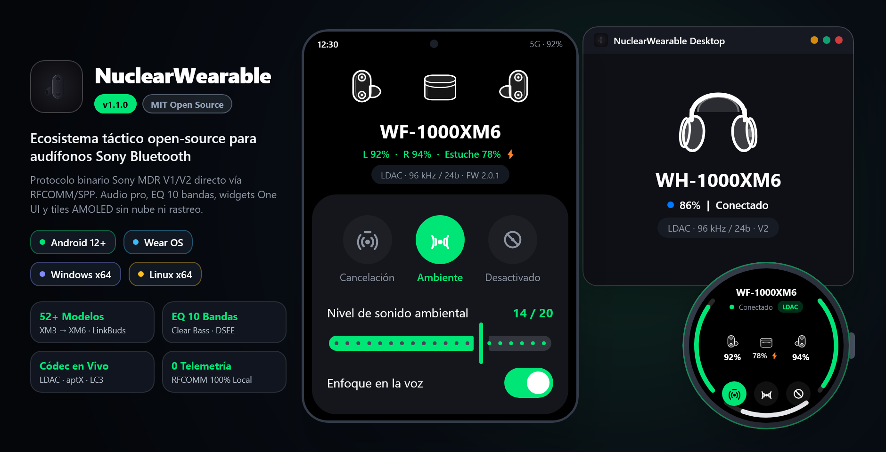
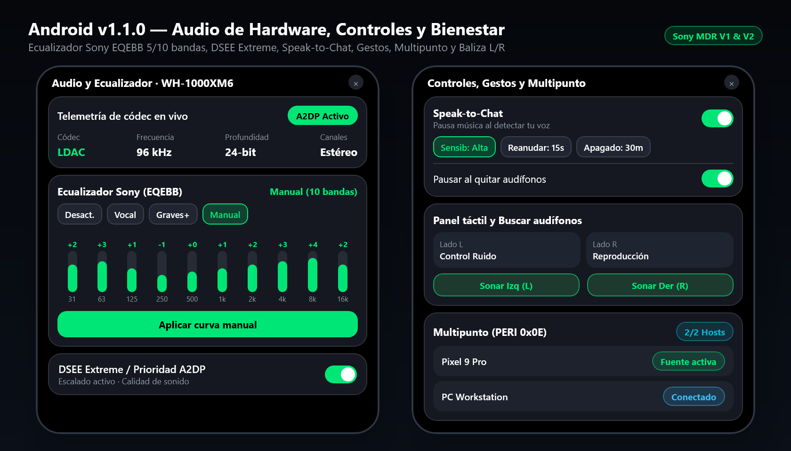
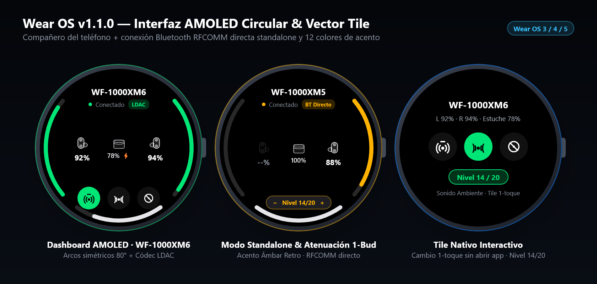
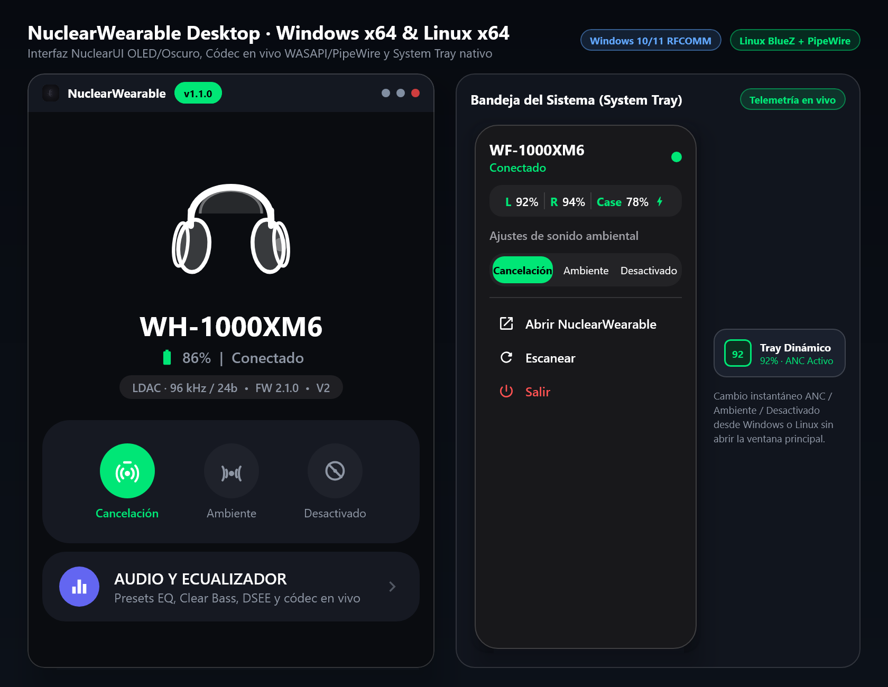
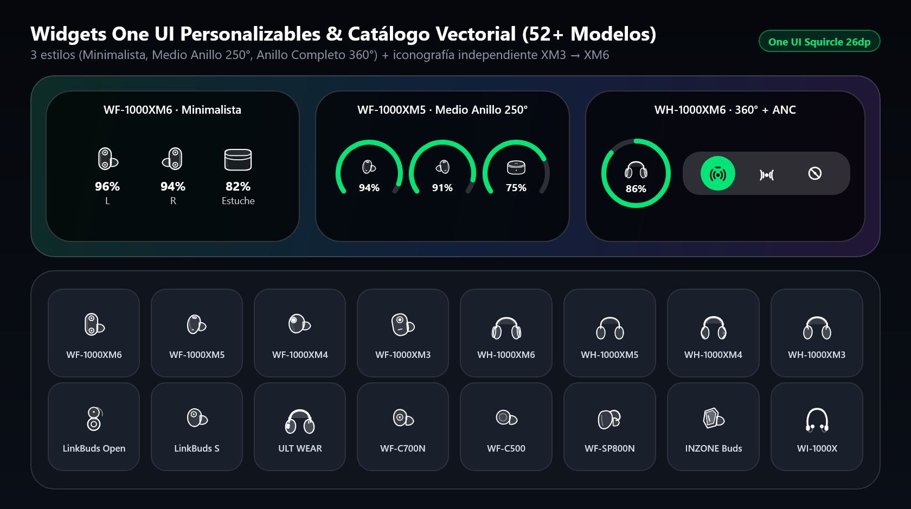

<div align="center">


# NuclearWearable

<strong>El ecosistema open-source, moderno y sin telemetría para audífonos inalámbricos Sony en Android, Wear OS, Windows 10/11 y Linux.</strong><br />
<em>The open-source, modern, telemetry-free ecosystem for Sony wireless headphones on Android, Wear OS, Windows 10/11, and Linux.</em>

<br />

[📥 Descargas v1.1.0](https://github.com/SebasNuclear/NuclearWearable/releases/tag/v1.1.0) · [📸 Capturas](#-capturas-del-ecosistema) · [🎧 Modelos Compatibles](#-modelos-sony-compatibles-52) · [🛠️ Compilar](#-compilación-desde-código-fuente) · [🇺🇸 English](#-english-overview)

<br />



</div>

---

## 📸 Capturas del Ecosistema

### Android — Audio Pro (EQ 10 Bandas), Controles de Confort & Multipunto
<p align="center">
  
</p>

### Wear OS — Dashboard AMOLED Circular, Standalone BT & Tile Interactivo
<p align="center">
  
</p>

### Desktop (Windows x64 & Linux x64) — App Principal & Bandeja del Sistema
<p align="center">
  
</p>

### Widgets One UI Personalizables (3 Estilos) & Catálogo Vectorial (52+ Modelos)
<p align="center">
  
</p>

---

## ⚡ ¿Qué trae NuclearWearable v1.1.0?

A diferencia de apps propietarias pesadas o dependientes de nube, **NuclearWearable** se comunica directamente por el socket **Bluetooth RFCOMM (Sony MDR V1 y V2 Dual-Table `0x0C` + `0x0E`)** con latencia mínima en Android, relojes Wear OS, Windows y Linux.

| Categoría | Funcionalidades principales en v1.1.0 |
| :--- | :--- |
| **🔇 Control de Ruido Rápido** | Conmutación instantánea **ANC / Sonido Ambiente (nivel `1..20` + Enfoque en voz) / Desactivado**, filtro dedicado de ruido de viento para `WF-1000XM4` (`0x15`) y prioridad RFCOMM sobre sondeo en segundo plano. |
| **🎛️ Audio Hardware & EQEBB** | Presets oficiales Sony y ecualizador manual de **5 bandas (`-10..+10`) + Clear Bass**, más **10 bandas (`0..12`, `31Hz..16kHz`)** en `WH-1000XM6`. Interruptor **DSEE / DSEE Extreme** y prioridad Bluetooth (**Calidad de sonido / Conexión estable / Baja latencia LE**). |
| **📡 Telemetría de Códec en Vivo** | HUD en tiempo real con el códec negociado (**`LDAC`**, **`aptX`**, **`AAC`**, **`SBC`**, **`LC3`**), frecuencia (`kHz`), profundidad (`bits`), canales, detección de llamadas HFP SCO y enlace rápido a Ajustes BT (`AudioCodecMonitor` / `WindowsAudioMonitor` / `LinuxAudioCodecMonitor`). |
| **🧘 Bienestar, Gestos & Multipunto** | **Speak-to-Chat** (sensibilidad, tiempo de retorno, enfoque vocal), **Pausa al retirar audífonos**, **Apagado automático**, **Apagado remoto seguro (V2)**, reasignación táctil **L/R** y bloqueo de panel táctil (`GS 0xD3`), **Guía de voz** (idioma/volumen) y **Multipunto (`PERI 0x0E`)** para 2 hosts simultáneos. |
| **📍 Automatización Local (0 Telemetría)** | Motor reactivo por evento de **llamada VoIP/celular**, **inicio de multimedia** y **horario local nocturno/estándar** con enfriamiento de 30s tras cambio manual. Sin GPS, sin Wi-Fi SSID y sin conexión a red. |
| **🔊 Find My Buds & Respaldo JSON** | Baliza estéreo PCM 44.1 kHz aislada **100% al canal Izquierdo o Derecho** con rampa segura de 4s y apagado automático a los 20s. Exportación/importación **JSON (`NuclearBackupBundle` v1)** interoperable entre Android, Windows y Linux + **Modo Lab Hex** con filtro y export `.txt`. |
| **⌚ Wear OS 3+ AMOLED & Tiles** | App compañera + modo **Standalone Bluetooth RFCOMM directo** en reloj, arcos de batería simétricos (`80°`), atenuación individual cuando un auricular está en el estuche, **Tiles con 3 círculos vectoriales in-place** (cambia ANC/Ambiente/Off sin abrir la app), **Complicación de carátula** fiel al modelo y selector de 12 colores. |
| **🪟 Widgets Samsung One UI** | 3 widgets de escritorio (`4x2 Dúo`, `Solo Batería`, `Solo Ruido`) con fondo squircle adaptativo (`0%..100%` opacidad), temas Claro/Oscuro OLED/Sistema y 3 estilos de anillos (**Minimalista**, **Medio Anillo `250°`**, **Anillo Completo `360°`**). |

---

## 🎧 Modelos Sony Compatibles (52+)

Motor de detección de **3 capas** (Firmware Hardware `0x04 0x01` → Caché persistente por MAC → Reglas de nombre/alias) + **filtro inteligente ANC** para ocultar controles de cancelación de ruido en modelos de solo batería:

| Serie / Familia | Modelos cubiertos | Tipo |
| :--- | :--- | :--- |
| **1000X TWS Flagship** | `WF-1000XM6`, `WF-1000XM5`, `WF-1000XM4`, `WF-1000XM3` | True Wireless + Estuche |
| **1000X Diadema Flagship** | `WH-1000XM6` (EQ 10 bandas), `WH-1000XM5`, `WH-1000XM4`, `WH-1000XM3`, `WH-1000XM2`, `MDR-1000X` | Over-Ear ANC |
| **LinkBuds Series** | `LinkBuds Open (WF-L910)`, `LinkBuds (WF-L900)` (sin ANC), `LinkBuds S (WF-LS900N)`, `LinkBuds Fit (WF-LS910N)` | True Wireless + Estuche |
| **ULT & Extra Bass** | `WH-ULT900N (ULT WEAR)`, `WH-XB910N`, `WH-XB900N`, `MDR-XB950N1`, `MDR-XB950B1`, `MDR-XB650BT` | Over-Ear ANC |
| **Serie CH** | `WH-CH720N`, `WH-CH710N`, `WH-CH700N` / `WH-CH520`, `WH-CH510`, `WH-CH500` (solo batería) | Over-Ear / On-Ear |
| **Serie C TWS** | `WF-C700N`, `WF-C710N` / `WF-C500`, `WF-C510` (solo batería) | True Wireless |
| **Sport & Gaming** | `WF-SP800N`, `WF-SP700N`, `INZONE Buds (WF-G700N)` | True Wireless |
| **h.ear & Collarín** | `WH-H910N (h.ear on 3)`, `WH-H900N (h.ear on 2)`, `WI-1000X`, `WI-1000XM2`, `WI-C100`, `WI-C200`, `WI-C310`, `WI-XB400` | Over-Ear / Neckband |

---

## 📥 Descargas Oficiales — v1.1.0

Descarga los binarios listos para usar en la sección de [**Releases v1.1.0**](https://github.com/SebasNuclear/NuclearWearable/releases/tag/v1.1.0):

| Plataforma | Archivo | Tamaño | Verificación SHA-256 |
| :--- | :--- | :--- | :--- |
| **Android 12–15** | `NuclearWearable_v1.1.0_release.apk` | `40.0 MiB` (`41,981,678` B) | `CB57FE69AFA926D5BAC01EF1D6C1882E7DDBED9667E53DAFA6FA1C21AD5E90DD` |
| **Wear OS 3–5** | `NuclearWearable_WearOS_v1.1.0_release.apk` | `26.8 MiB` (`28,146,350` B) | `030BAA2E6ED4B3E67EAD1E76AF70C1AF4F1C5B2204DDF79578B62D0253713330` |
| **Windows x64 Portable** | `NuclearWearable_Windows_v1.1.0_release.exe` | `120.2 MiB` (`125,987,328` B) | `839F2747C93FA2DC118CBFE0EA58E932672FC4DE2083603F83AACB454F9245B3` |
| **Linux x64 Desktop** | `NuclearWearable_Linux_x64_v1.1.0.jar` | `76.8 MiB` (`80,576,089` B) | `92F3959DC0E7D1F9FC828166BF2DF1D1E5E1FEF67FF8102532E181082B033617` |

### Notas rápidas de instalación
- **Android / Wear OS:** Ambas APKs comparten firma unificada (`nuclear_ecosystem.keystore`, SHA-256 `bd944ae0...784`) para que la capa Wearable Data Layer entre móvil y reloj funcione automáticamente. Si Google Play Protect muestra *"Desarrollador desconocido"* por sideloading manual, pulsa **Más detalles → Instalar de todas formas**.
- **Windows x64:** Ejecutable portable autoextraíble (`.exe`): incluye JVM y librerías nativas Compose/Skia, **no requiere instalar Java**. Si Windows SmartScreen avisa en la primera ejecución por ser binario open-source sin certificado comercial, pulsa **Más información → Ejecutar de todas formas**.
- **Linux x64:** Funciona **sin root (`sudo`)** sobre **BlueZ + PipeWire / PulseAudio** (`JDK 17+`):
  ```bash
  java -jar NuclearWearable_Linux_x64_v1.1.0.jar
  ```

---

## 🏗️ Arquitectura del Monorepo

```text
NuclearWearable/
├── core/                  # Protocolo compartido Android + Wear OS (MDR V1/V2, ARQ, SonyModels, WearProtocol)
├── app/                   # App móvil Android (Jetpack Compose, Material 3, One UI Widgets, QS Tile, EQ/Lab/Backup)
├── wear/                  # App reloj Wear OS (Compose Wear AMOLED, Standalone RFCOMM, Vector Tiles, Complication)
├── windows/               # Cliente nativo Windows x64 (Compose Desktop, Winsock JNA, WASAPI HUD, Tray, EXE launcher)
├── linux/                 # Cliente nativo Linux x64 (Compose Desktop, BlueZ D-Bus + JNA libc AF_BLUETOOTH, PipeWire)
└── docs/                  # Guías de diseño NuclearUI, widgets y capturas oficiales (docs/screenshots/)
```

---

## 🛡️ Privacidad y Permisos

- **Cero permiso `INTERNET`** en `:app`, `:core` y `:wear`.
- **Cero geolocalización / Wi-Fi SSID:** no se solicitan permisos de ubicación (`neverForLocation` en `BLUETOOTH_SCAN`).
- Todas las preferencias, historial de baterías, automatizaciones y respaldos `.json` se guardan localmente en tu dispositivo (`SharedPreferences`, `%LOCALAPPDATA%\NuclearWearable` en Windows o `~/.config/NuclearWearable` en Linux).

---

## 🛠️ Compilación desde Código Fuente

<details>
<summary>Instrucciones de compilación y tests por plataforma</summary>

### Android & Wear OS
```bash
# Compilar APKs Release desde la raíz del repo
./gradlew :app:assembleRelease :wear:assembleRelease

# Ejecutar tests unitarios del módulo compartido :core
./gradlew :core:testReleaseUnitTest
```

### Windows x64 (`windows/`)
```powershell
cd windows
.\gradlew.bat cleanTest test packageUberJarForCurrentOS --no-daemon
```

### Linux x64 (`linux/`)
```bash
cd linux
./gradlew cleanTest test packageUberJarForCurrentOS --no-daemon
# Opcional: paquetes .deb / .AppImage
./packaging/linux/build-linux.sh
./packaging/linux/appimage-build.sh
```

</details>

---

## 🇺🇸 English Overview

**NuclearWearable v1.1.0** is an open-source, offline, zero-telemetry controller ecosystem for **52+ Sony wireless headphones & earbuds** (`WF/WH-1000XM3 → XM6`, `LinkBuds`, `ULT WEAR`, `WF-C`, `INZONE`, `CH/WI` series) across **Android 12+**, **Wear OS 3+**, **Windows x64**, and **Linux x64**.

- **Direct Sony MDR V1/V2 Protocol:** Speaks binary RFCOMM/SPP natively (`Table 1 0x0C` & `Table 2 0x0E`) with user preemption, hardware 5/10-band EQ (`EQEBB`) + Clear Bass, DSEE, Bluetooth connection priority (incl. LE Audio), Speak-to-Chat, wear sensor pause, WF-1000XM4 wind-noise reduction, custom touch mapping, voice guidance, and Multipoint host management.
- **Zero-Telemetry Phase 3 Engines:** Live codec & HFP SCO HUD (`LDAC / aptX / AAC / SBC / LC3`), completely offline automation (calls, media playback, local schedule — no GPS or Wi-Fi SSIDs), isolated stereo L/R Find My Buds beacon, cross-platform JSON profile backups (`NuclearBackupBundle` v1), and a live RFCOMM Hex Monitor.
- **Native System Integration:** Android Quick Settings Tile + 3 One UI Home Widget styles; Wear OS circular AMOLED UI + standalone RFCOMM mode + interactive vector Tiles + Complications; Windows Winsock RFCOMM + WASAPI HUD + zero-install portable `.exe`; and rootless Linux BlueZ/L2CAP SDP + PipeWire/MPRIS + XDG config.

---

## 🏷️ Especificaciones / Specifications

<p align="center">
  <a href="https://github.com/SebasNuclear/NuclearWearable/releases/tag/v1.1.0"></a>
  <a href="app/"></a>
  <a href="wear/"></a>
  <a href="windows/"></a>
  <a href="linux/"></a>
  
  <a href="LICENSE"></a>
</p>

---

## 📄 Licencia / License

MIT License © 2026 **SebasNuclear**. Consulte el archivo [**`LICENSE`**](LICENSE) para más información.

*Sony, Walkman, LinkBuds, INZONE and model names are registered trademarks of Sony Group Corporation. This project is an independent open-source implementation and is not affiliated with Sony.*
