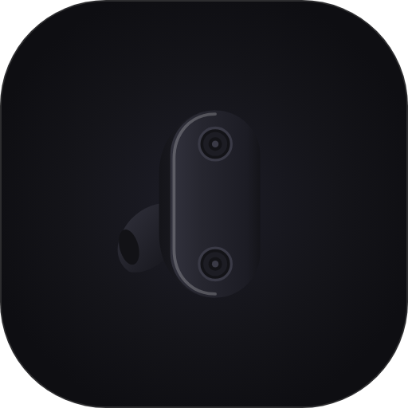

<p align="center">
  
</p>

<h1 align="center">NuclearWearable</h1>

<p align="center">
  <strong>El ecosistema minimalista, moderno y sin telemetría para audífonos inalámbricos Sony en Android, Wear OS y Windows 10/11.</strong><br>
  <em>The minimalist, modern, telemetry-free ecosystem for Sony wireless headphones on Android, Wear OS, and Windows 10/11.</em>
</p>

<p align="center">
  <a href="#-español"><b>Español</b></a> &nbsp;|&nbsp; <a href="#-english"><b>English</b></a>
</p>

---

<a name="-español"></a>
## 🇪🇸 Español

**NuclearWearable** es una suite multiplataforma de código abierto diseñada para controlar y monitorear audífonos inalámbricos Sony mediante comunicación directa con el protocolo nativo **Sony MDR (v1/v2)** sobre Bluetooth RFCOMM. Ofrece una experiencia visual limpia, rápida y completamente privada en teléfono, reloj inteligente y computadora.

---

### 🌐 Ecosistema Multiplataforma

#### 📱 Android (Teléfono y Tablet)
* **Control Acústico Instantáneo:** Conmutación sin latencia entre Cancelación Activa de Ruido (ANC), Sonido Ambiente (ajustable en 20 niveles con opción de *Enfoque en la voz*) y modo Desactivado.
* **Widgets Interactivos One UI:** Widgets para la pantalla de inicio con anillos de batería en tiempo real, siluetas vectoriales del modelo conectado y botones táctiles de control de ruido.
* **Interfaz Adaptativa (Vertical y Horizontal):** Diseño responsivo que en orientación horizontal divide la pantalla en dos paneles independientes para navegar por el catálogo y los controles con fluidez.
* **Puente de Sincronización Wearable:** Servicio integrado en segundo plano que sincroniza el estado de los audífonos, baterías, tema de color y comandos con el reloj inteligente mediante *Wearable Data Layer*.

#### ⌚ Wear OS (Smartwatch)
* **Arquitectura Híbrida Dual:** Funciona tanto sincronizado con el teléfono (modo *Companion Proxy*) como conectado directamente por Bluetooth a los audífonos de forma autónoma (modo *Standalone RFCOMM*).
* **Visualización AMOLED Circular:** Arcos de batería independientes para auricular izquierdo (`L`), derecho (`R`) y `Estuche`, acompañados de los iconos vectoriales del modelo y el color de acento sincronizado desde el teléfono.
* **Control de Ambiente desde la Muñeca:** Ajuste directo de modos ANC, Ambiente, selector gradual de niveles (1 a 20) y activación de *Enfoque en la voz*.
* **Tarjetas Deslizables (Tiles) y Complicaciones:** Incluye una tarjeta principal detallada (batería + controles), una tarjeta compacta de botones rápidos en fila estilo One UI (`ANC` / `Ambiente` / `Off`) y soporte de complicaciones para carátulas de reloj.

#### 💻 Windows 10 / 11 (Escritorio x64)
* **Integración en Bandeja del Sistema (System Tray):** Acceso rápido desde la barra de tareas con indicadores dinámicos de conexión y carga.
* **Monitoreo y Control en Escritorio:** Lectura en tiempo real del porcentaje de batería de cada auricular y del estuche, junto con control completo de cancelación de ruido y sonido ambiente desde la PC.
* **Ejecución Ligera:** Aplicación nativa de escritorio sin procesos pesados en segundo plano ni servicios de telemetría.

---

### ✨ Características Principales

#### 1. 🎧 Soporte Universal Sony (52+ Modelos en 16 Familias Industriales)
Vectores nativos independientes dibujados a mano respetando la geometría real de cada modelo, sus estuches de carga y diademas:
* **True Wireless (TWS):** WF-1000XM6, WF-1000XM5, WF-1000XM4, WF-1000XM3, LinkBuds S, LinkBuds Open, LinkBuds Fit, WF-C700N, WF-C500, WF-C510, WF-SP800N, INZONE Buds (PlayStation).
* **Diadema & Cuello (Over-Ear / Neckband):** WH-1000XM6, WH-1000XM5, WH-1000XM4, WH-1000XM3, WH-1000XM2, MDR-1000X, ULT WEAR (WH-ULT900N), WH-CH720N, WH-CH520, WH-XB910N, MDR-XB950, WH-H910N, WI-1000X, WI-C100.

#### 2. 🔍 Motor de Detección Inteligente de 3 Capas
Identifica con exactitud el modelo conectado incluso si tiene un nombre personalizado en los ajustes de Bluetooth (ej. *"Mis audífonos"*):
* **Capa 1 (Firmware):** Consulta directa al chip Sony mediante el protocolo RFCOMM MDR.
* **Capa 2 (Caché MAC):** Asociación persistente con la dirección física MAC del dispositivo.
* **Capa 3 (Selector Manual):** Catálogo interactivo con buscador y filtros por categoría (Todos, TWS, Diadema) para fijar el modelo manualmente en cualquier momento.

#### 3. 🛡️ Adaptación Dinámica según Hardware
Para modelos que no disponen de Cancelación Activa de Ruido por hardware (ej. WF-C500, WH-CH520, WI-C100 o LinkBuds Open), la interfaz, los widgets y el reloj ocultan automáticamente los controles ANC, presentando una vista limpia enfocada en el estado de batería y conexión.

#### 4. 🎨 Sistema de Diseño NuclearUI
* Estética inspirada en One UI con esquinas *squircle* redondeadas (`26.dp`), tipografía natural y contraste negro puro (`#000000`) optimizado para pantallas OLED.
* Paletas de color de acento personalizables que se reflejan en toda la aplicación, widgets y reloj inteligente.
* Soporte bilingüe nativo al 100% (**Español / English**) con cambio instantáneo dentro de la aplicación.

#### 5. 🔒 Privacidad Absoluta y Cero Telemetría
* Sin permisos de acceso a internet en segundo plano.
* Sin anuncios, cuentas obligatorias, librerías de analíticas ni rastreadores.
* Permisos Bluetooth estrictamente locales (`BLUETOOTH_CONNECT`, `BLUETOOTH_SCAN` con flag `neverForLocation`).

---

### 📋 Catálogo de Compatibilidad

| Familia Industrial | Tipo | ANC | Modelos Cubiertos |
| :--- | :---: | :---: | :--- |
| **WF-1000XM6** | TWS | ✅ | WF-1000XM6 (Serie 1000X Flagship) |
| **WF-1000XM5** | TWS | ✅ | WF-1000XM5 |
| **WF-1000XM4** | TWS | ✅ | WF-1000XM4 |
| **WF-1000XM3** | TWS | ✅ | WF-1000XM3 |
| **WH-1000XM6** | Over-Ear | ✅ | WH-1000XM6 |
| **WH-1000XM5** | Over-Ear | ✅ | WH-1000XM5 |
| **WH-1000XM4** | Over-Ear | ✅ | WH-1000XM4 |
| **WH-1000XM3** | Over-Ear | ✅ | WH-1000XM3, WH-1000XM2, MDR-1000X |
| **LinkBuds Open** | TWS | ❌ | LinkBuds (WF-L900), LinkBuds Open (WF-L910) |
| **LinkBuds S** | TWS | ✅ | LinkBuds S (WF-LS900N), LinkBuds Fit (WF-LS910N) |
| **ULT WEAR** | Over-Ear | ✅ | WH-ULT900N (ULT WEAR Heavy Bass) |
| **WH-CH720N** | Over-Ear | ✅ | WH-CH720N, WH-CH710N, WH-CH700N |
| **WH-CH520** | Over-Ear | ❌ | WH-CH520, WH-CH510, WH-CH500 |
| **WH-XB910N** | Over-Ear | ✅ | WH-XB910N, WH-XB900N (Extra Bass) |
| **WF-C700N** | TWS | ✅ | WF-C700N, WF-C710N |
| **WF-C500** | TWS | ❌ | WF-C500, WF-C510 |
| **WF-SP800N** | TWS | ✅ | WF-SP800N, WF-SP700N |
| **WI-1000X** | Collar | ✅ | WI-1000X, WI-1000XM2 |
| **WI-C100** | Collar | ❌ | WI-C100, WI-C200, WI-C310, WI-XB400 |
| **INZONE Buds** | TWS | ✅ | INZONE Buds (WF-G700N PlayStation) |
| **MDR-XB950** | Over-Ear | ✅ | MDR-XB950N1, MDR-XB950B1, MDR-XB650BT |
| **WH-H910N** | Over-Ear | ✅ | WH-H910N (h.ear on 3), WH-H900N (h.ear on 2) |

---

### 📲 Descarga e Instalación

Dirígete a la sección de **[Releases](https://github.com/SebasNuclear/NuclearWearable/releases/tag/v1.0.0)** y descarga el paquete correspondiente a tus dispositivos:

1. **Android (Teléfono / Tablet):**
   * Descarga e instala **`NuclearWearable_Phone_v1.0.0.apk`**.
   * Concede los permisos de Bluetooth al abrir la aplicación.
2. **Wear OS (Reloj Inteligente):**
   * Descarga **`NuclearWearable_Watch_v1.0.0.apk`**.
   * Instálalo en tu reloj mediante *Wear Installer*, *Bugjaeger* o vía ADB (`adb install NuclearWearable_Watch_v1.0.0.apk`).
   * Asegúrate de tener instalada la aplicación en tu teléfono para habilitar la sincronización automática de estado y color.
3. **Windows 10 / 11 (PC x64):**
   * Descarga y ejecuta **`NuclearWearable_v1.0.0_Windows_x64.exe`**.

> [!NOTE]
> **Aviso de instalación independiente (Google Play Protect / Windows SmartScreen):**  
> Al distribuirse de forma directa y abierta fuera de tiendas comerciales, el sistema puede mostrar un aviso preventivo de *"Desarrollador no reconocido"*. En Android basta con pulsar **"Más detalles" ➔ "Instalar de todas formas"**; en Windows, **"Más información" ➔ "Ejecutar de todas formas"**. El código fuente es 100% abierto, auditable y libre de conexiones a internet.

---

### 🛠️ Compilación desde el Código Fuente

```bash
# Clonar el repositorio
git clone https://github.com/SebasNuclear/NuclearWearable.git
cd NuclearWearable

# Compilar APKs firmados de Android y Wear OS
./gradlew :app:assembleRelease :wear:assembleRelease
```

Los binarios generados se ubican en:
* **Android:** `app/build/outputs/apk/release/app-release.apk`
* **Wear OS:** `wear/build/outputs/apk/release/wear-release.apk`
* **Librería Core:** `core/build/outputs/aar/core-release.aar`

---

<a name="-english"></a>
## 🇬🇧 English

**NuclearWearable** is an open-source multiplatform suite designed to control and monitor Sony wireless headphones through direct communication with the native **Sony MDR (v1/v2)** protocol over Bluetooth RFCOMM. It delivers a clean, fast, and completely private experience across your phone, smartwatch, and desktop PC.

---

### 🌐 Multiplatform Ecosystem

#### 📱 Android (Phone & Tablet)
* **Instant Acoustic Control:** Zero-latency switching between Active Noise Cancellation (ANC), Ambient Sound (adjustable across 20 levels with *Voice Passthrough*), and Off mode.
* **Interactive One UI Widgets:** Home screen widgets featuring real-time battery rings, vector silhouettes of your connected model, and touch noise control toggles.
* **Adaptive Layout (Portrait & Landscape):** Responsive design that automatically splits into a two-column view in landscape mode for effortless browsing and control.
* **Wearable Sync Bridge:** Background service that synchronizes headphone telemetry, battery levels, accent color themes, and remote commands with your Wear OS watch via the *Wearable Data Layer*.

#### ⌚ Wear OS (Smartwatch)
* **Dual Hybrid Architecture:** Operates seamlessly either paired with your phone (*Companion Proxy* mode) or connected directly via Bluetooth to your headphones (*Standalone RFCOMM* mode).
* **Circular AMOLED Display:** Independent battery arcs for Left (`L`), Right (`R`), and charging case, paired with crisp model-specific vector icons and automatic accent color synchronization.
* **Wrist Ambient Control:** Full switching between ANC, Ambient mode, a 1–20 level stepper, and *Voice Focus* toggle directly from your watch.
* **Tiles & Watch Face Complications:** Includes a full dashboard Tile (battery capsules + ANC toggles), a compact single-row Quick Controls Tile (`ANC` / `Ambient` / `Off`), and Watch Face Complication support.

#### 💻 Windows 10 / 11 (Desktop x64)
* **System Tray Integration:** Quick access from the Windows taskbar with dynamic connection and battery indicators.
* **Desktop Monitoring & Control:** Real-time battery readout for individual earbuds and the charging case, along with direct ANC and Ambient Sound control from your PC.
* **Lightweight Native Execution:** Built for minimal resource footprint with zero background bloatware or telemetry services.

---

### ✨ Key Features

#### 1. 🎧 Universal Sony Support (52+ Models in 16 Design Families)
Hand-crafted native vectors respecting the authentic geometry of each model, its charging case, and headband:
* **True Wireless (TWS):** WF-1000XM6, WF-1000XM5, WF-1000XM4, WF-1000XM3, LinkBuds S, LinkBuds Open, LinkBuds Fit, WF-C700N, WF-C500, WF-C510, WF-SP800N, INZONE Buds (PlayStation).
* **Headband & Neckband (Over-Ear / Neckband):** WH-1000XM6, WH-1000XM5, WH-1000XM4, WH-1000XM3, WH-1000XM2, MDR-1000X, ULT WEAR (WH-ULT900N), WH-CH720N, WH-CH520, WH-XB910N, MDR-XB950, WH-H910N, WI-1000X, WI-C100.

#### 2. 🔍 3-Layer Intelligent Detection Engine
Accurately identifies your exact hardware model even if renamed in Bluetooth settings (e.g. *"My Headphones"*):
* **Layer 1 (Firmware):** Direct query to the Sony chip via RFCOMM MDR protocol.
* **Layer 2 (MAC Cache):** Persistent association with the device's physical MAC address.
* **Layer 3 (Manual Selector):** Interactive catalog with search and category filters (All, TWS, Over-Ear) to lock your model manually at any time.

#### 3. 🛡️ Dynamic Hardware Adaptation
For headphones without hardware Active Noise Cancellation (e.g. WF-C500, WH-CH520, WI-C100, LinkBuds Open), the app, widgets, and smartwatch interface automatically hide ANC controls, presenting a streamlined layout focused on battery and connection status.

#### 4. 🎨 NuclearUI Design System
* One UI-inspired aesthetic with rounded squircle corners (`26.dp`), clean typography, and pitch-black contrast (`#000000`) tailored for OLED displays.
* Customizable accent color palettes synchronized across the mobile app, widgets, and smartwatch.
* 100% native bilingual support (**Spanish / English**) with instant in-app switching.

#### 5. 🔒 Absolute Privacy & Zero Telemetry
* No background internet permissions.
* No ads, mandatory accounts, analytics libraries, or trackers.
* Strictly local Bluetooth communication (`BLUETOOTH_CONNECT`, `BLUETOOTH_SCAN` with `neverForLocation`).

---

### 📲 Download & Installation

Visit the **[Releases](https://github.com/SebasNuclear/NuclearWearable/releases/tag/v1.0.0)** page and download the package for your platform:

1. **Android (Phone / Tablet):**
   * Download and install **`NuclearWearable_Phone_v1.0.0.apk`**.
   * Grant standard Bluetooth permissions when prompted.
2. **Wear OS (Smartwatch):**
   * Download **`NuclearWearable_Watch_v1.0.0.apk`**.
   * Sideload it to your watch using *Wear Installer*, *Bugjaeger*, or ADB (`adb install NuclearWearable_Watch_v1.0.0.apk`).
   * Keep the phone app installed to enable automatic state and theme synchronization.
3. **Windows 10 / 11 (Desktop x64):**
   * Download and run **`NuclearWearable_v1.0.0_Windows_x64.exe`**.

> [!NOTE]
> **Independent Distribution Notice (Google Play Protect / Windows SmartScreen):**  
> When installing open-source binaries outside commercial app stores, the OS may display an *"Unrecognized developer"* prompt. On Android, tap **"More details" ➔ "Install anyway"**; on Windows, click **"More info" ➔ "Run anyway"**. The entire codebase is open-source, auditable, and operates 100% offline.

---

### 🛠️ Building from Source

```bash
# Clone the repository
git clone https://github.com/SebasNuclear/NuclearWearable.git
cd NuclearWearable

# Build signed Release APKs for Android and Wear OS
./gradlew :app:assembleRelease :wear:assembleRelease
```

Compiled binaries are located at:
* **Android:** `app/build/outputs/apk/release/app-release.apk`
* **Wear OS:** `wear/build/outputs/apk/release/wear-release.apk`
* **Core Library:** `core/build/outputs/aar/core-release.aar`

---

## 🏷️ Specifications

<p align="center">
  
  
  
  
  
</p>

---

## 📄 Licencia / License

MIT License © 2026 SebasNuclear. Consulte el archivo `LICENSE` para más información.

*Sony, Walkman, LinkBuds, INZONE and model names are registered trademarks of Sony Group Corporation. This project is an independent open-source implementation and is not affiliated with Sony.*
